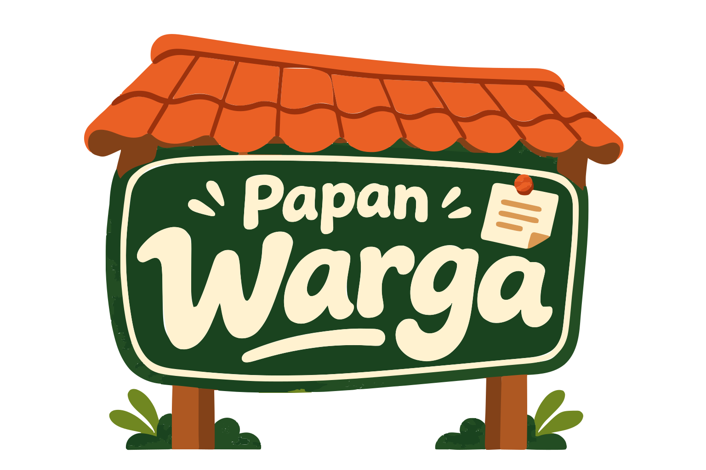

  

<h1 align="center">Papan Warga</h1>

  <strong>Aplikasi komunitas dan administrasi lingkungan RT, dirancang agar mudah dipahami lintas usia.</strong>

  Prototype awal · Satu instalasi untuk satu RT · Kode tersedia · Aplikasi wajib gratis

  <a href="#ruang-lingkup-versi-pertama">Fitur</a> ·
  <a href="#teknologi">Teknologi</a> ·
  <a href="#roadmap">Roadmap</a> ·
  <a href="#masukan-dan-kontribusi">Kontribusi</a> ·
  <a href="#lisensi-kode-logo-dan-aset">Lisensi</a>

---

Papan Warga membantu pengurus dan warga mengakses pengumuman, kegiatan, informasi lingkungan, serta administrasi rumah dan iuran dalam satu tempat. Arah desainnya hangat, dekat dengan lingkungan Indonesia, dan mengutamakan penggunaan lewat HP.

Proyek ini mulai dirancang pada **7 November 2026 (7·11)**.

> **Status: rancangan awal dan prototype.**  
> Repository ini saat ini berisi dokumentasi awal. Prototype HTML telah dibuat terpisah dan belum disertakan di repository. Aplikasi Laravel, installer, database, serta integrasi layanan belum dirilis. Belum siap digunakan untuk operasional RT atau data warga sesungguhnya.

## Tujuan

- Memudahkan pengurus mengelola informasi, data warga, iuran, dan kas.
- Membantu warga menemukan informasi serta tagihan rumahnya dengan mudah.
- Menggunakan tulisan yang jelas, tombol yang mudah disentuh, dan navigasi sederhana.
- Mendukung satu instalasi untuk satu RT dengan konfigurasi melalui formulir.
- Mengembangkan aplikasi yang gratis untuk seluruh warga yang membutuhkan. Kode boleh dipelajari, disalin, dan dikembangkan oleh siapa pun, termasuk di luar repository ini, dengan ketentuan aplikasi asli maupun versi turunannya tetap dibagikan gratis dan tidak dijual.

Jasa pemasangan, migrasi, pelatihan, atau penyesuaian dapat ditawarkan secara terpisah dan opsional. Biaya jasa atau infrastruktur harus dijelaskan secara transparan; bukan harga lisensi atau akses aplikasi. Warga harus tetap dapat memperoleh dan menggunakan aplikasi secara mandiri tanpa membeli jasa tersebut.

## Yang sudah disiapkan

- Blueprint kebutuhan dan batas versi pertama.
- Prototype HTML mandiri dengan CSS dan JavaScript.
- Dashboard pengurus serta mockup tampilan HP warga.
- Simulasi pencarian warga, pencatatan dan verifikasi iuran, serta wizard pemasangan.
- Arah visual krem, hijau tua, dan terakota; logo berbentuk papan pengumuman.

Semua nama, alamat rumah, dan transaksi dalam prototype adalah **data contoh fiktif**. Interaksi prototype bukan transaksi nyata. Perubahan demo hilang saat halaman dimuat ulang.

## Ruang lingkup versi pertama

| Modul | Cakupan yang direncanakan |
| --- | --- |
| Identitas lingkungan | RT/RW, wilayah, kontak pengurus, dan logo |
| Rumah dan warga | Rumah, KK, anggota keluarga, status pindah, serta impor CSV dengan preview |
| Iuran | Tagihan per rumah, pembayaran tunai/transfer, pembayaran sebagian, dan verifikasi |
| Buku kas | Pemasukan, pengeluaran, koreksi beralasan, laporan, dan ekspor |
| Papan informasi | Pengumuman, agenda, serta lampiran |
| Akun dan peran | Administrator, ketua RT, sekretaris, bendahara, dan warga |
| Operasional | Pengaturan, riwayat perubahan, backup, pemulihan, dan panduan |

**Rumah dan KK dibedakan:** satu rumah dapat memiliki beberapa KK. Rancangan awal menggunakan tagihan per rumah; kebijakan akhirnya ditinjau bersama RT pilot. NIK dan foto KK tidak diwajibkan untuk penggunaan dasar.

## Fitur lanjutan

Fitur berikut akan dievaluasi setelah alur utama stabil:

- Pengajuan surat dan pengaduan warga.
- Bank sampah, inventaris, jadwal ronda, dan kegiatan khusus.
- Notifikasi eksternal.
- CCTV lingkungan.
- Permintaan bantuan warga melalui dua langkah di layar.

**CCTV dan bantuan darurat pada prototype hanya simulasi.** Belum ada kamera, penerima bantuan, alarm, atau pengiriman notifikasi yang terhubung. Implementasi nyata memerlukan pengujian perangkat, jaringan, akses pengguna, konfirmasi penerimaan, pembatalan, dan jalur cadangan.

## Teknologi

| Bagian | Pilihan / status |
| --- | --- |
| Prototype saat ini | HTML, CSS, JavaScript murni |
| Backend aplikasi | Laravel — direncanakan |
| Template tampilan | Blade dengan interaksi ringan; Alpine.js sebagai kandidat |
| Database utama | MySQL / MariaDB — kandidat |
| Pengembangan lokal | Laragon, Composer, dan Node.js untuk membangun aset |
| Akses pengguna | Web responsif; PWA dievaluasi setelah fondasi stabil |
| Distribusi | Kode sumber, dokumentasi, dan paket siap pasang setelah pengujian |

Versi PHP, framework, ekstensi, dan persyaratan hosting belum dikunci. Pilihan tersebut akan diverifikasi saat implementasi. SQLite hanya dipertimbangkan jika alur operasional dan pemulihannya telah diuji.

Target paket siap pasang adalah menyertakan dependency produksi dan aset yang sudah dibangun, sehingga pengguna akhir tidak perlu menjalankan proses build Node.js.

## Menjalankan prototype

Prototype HTML belum tersedia di repository ini. Belum ada perintah instalasi aplikasi Laravel atau paket rilis yang dapat dijalankan.

Jika Anda memperoleh file prototype HTML dari pengelola proyek:

1. Unduh file HTML.
2. Buka langsung menggunakan browser modern.
3. Coba tab prototype interaktif, mockup, serta teknologi dan rencana.

Prototype tidak memerlukan PHP atau database. Jangan memasukkan identitas atau data warga sesungguhnya ke dalam contoh demo.

## Prinsip pengelolaan data

Ketentuan berikut merupakan **target implementasi**, belum menjadi jaminan kemampuan prototype:

- Akses data dibatasi sesuai peran dan rumah yang ditautkan ke akun warga.
- Tunggakan per rumah, identitas, kontak pribadi, dan bukti pembayaran tidak menjadi informasi publik.
- Bukti transfer menunggu verifikasi sebelum menambah kas.
- Verifikasi berulang tidak membuat pemasukan ganda.
- Pembayaran sebagian menghitung sisa tagihan; kelebihan bayar ditolak pada versi pertama.
- Koreksi transaksi terverifikasi memakai pembatalan atau pembalik disertai alasan.
- Perpindahan warga mempertahankan riwayat yang masih diperlukan.
- Backup mencakup database dan lampiran; pemulihan harus diuji sebelum rilis.

## Roadmap

- [x] Rancangan produk dan blueprint awal.
- [x] Prototype dashboard pengurus dan mockup HP warga.
- [x] Pemilihan arah visual dan logo.
- [x] Penetapan kebijakan aplikasi wajib gratis dan ketentuan terpisah untuk logo Panji.
- [ ] Perapian prototype dan aset untuk ditambahkan ke repository.
- [ ] Uji alur bersama pengurus dan warga, termasuk lansia.
- [ ] Penetapan RT pilot, kebijakan tagihan, hosting, dan ketentuan aset selain logo.
- [ ] Fondasi Laravel, wizard pemasangan, akun, serta hak akses.
- [ ] Rumah, KK, anggota keluarga, dan impor CSV.
- [ ] Iuran, verifikasi, buku kas, serta laporan.
- [ ] Pengumuman, agenda, audit perubahan, dan backup.
- [ ] Uji pemasangan bersih, pemulihan, dan akses antar-rumah.
- [ ] Pilot satu RT, perbaikan, dokumentasi, dan calon rilis.

Urutan ini dapat berubah mengikuti hasil uji pengguna. Belum ada tanggal rilis produksi yang ditetapkan.

## Kriteria calon rilis

- Instalasi baru dapat dilakukan mengikuti panduan tanpa mengedit source code.
- Warga tidak dapat mengakses data rumah lain melalui perubahan URL.
- Saldo kas dan status tagihan konsisten pada pembayaran tunai, transfer, sebagian, serta koreksi.
- Backup berhasil dipulihkan di instalasi percobaan.
- Tindakan utama dapat ditemukan dan digunakan lewat HP.
- Tersedia panduan pemasangan, penggunaan, pembaruan, dan pelaporan masalah.

## Berkas yang dibagikan ke repository

Tahap awal difokuskan pada dokumentasi dan materi demo yang telah diperiksa.

| Cocok dibagikan setelah ditinjau | Tidak dibagikan |
| --- | --- |
| README, roadmap, dan panduan | Data warga, NIK/KK, kontak pribadi |
| Prototype dan mockup dengan data fiktif | Database operasional dan backup |
| Kode sumber tanpa konfigurasi rahasia | File `.env`, kata sandi, token, API key |
| Logo dan ilustrasi dengan ketentuan penggunaan yang jelas | Bukti pembayaran dan dokumen unggahan warga |
| Contoh konfigurasi dengan nilai placeholder | Alamat perangkat, kredensial CCTV, atau tautan stream privat |

Gunakan `.gitignore` untuk berkas lokal dan rahasia sebelum mulai menambahkan kode. Periksa juga berkas yang sudah terlacak Git; `.gitignore` bukan pengganti pemeriksaan isi dan riwayat commit.

Panduan terkait: [Mencegah dan menangani data sensitif di repository — GitHub Docs](https://docs.github.com/en/authentication/keeping-your-account-and-data-secure/removing-sensitive-data-from-a-repository).

## Masukan dan kontribusi

Pada tahap ini, masukan yang paling dibutuhkan adalah:

- Kebutuhan nyata pengurus dan warga.
- Kemudahan membaca serta menggunakan tampilan lewat HP.
- Praktik penagihan per rumah atau per KK.
- Alur koreksi data, pemulihan akun, dan pemasangan mandiri.

Silakan gunakan [Issues](https://github.com/trisindopanji/papan-warga/issues) untuk usulan dan masalah pada materi demo. Sertakan langkah reproduksi dan data fiktif. Jangan menyertakan identitas warga, kredensial, atau dokumen pribadi di issue publik.

Usulan dan perbaikan sangat terbuka untuk didiskusikan melalui Issues. Pull request juga dipersilakan ketika kode tersedia di repository ini. Untuk perubahan besar yang ingin digabungkan ke repository utama, diskusikan arahnya terlebih dahulu agar sesuai dengan fokus proyek.

Anda boleh menyalin, membuat fork, dan mengembangkan kode secara mandiri di repository lain atau di luar GitHub ini sesuai ketentuan wajib gratis di bawah. Tidak wajib mengirim perubahan kembali atau meminta persetujuan pengelola untuk pengembangan yang memenuhi ketentuan tersebut. Diskusi perubahan di atas hanya berlaku bagi kontribusi yang ingin digabungkan ke proyek utama. Kontribusi yang digabungkan harus dapat dibagikan dengan ketentuan yang sama.

## Lisensi kode, logo, dan aset

### Kode: ketentuan wajib gratis Papan Warga

Copyright (c) 2026 Panji R. Trisindo.

Papan Warga dibuat agar seluruh warga yang membutuhkan dapat menggunakan aplikasi secara gratis. Kode sumber dan dokumentasi teknis asli proyek tersedia dengan ketentuan khusus berikut:

1. Siapa pun boleh menggunakan, mempelajari, menyalin, memodifikasi, dan mengembangkan kode, termasuk di luar repository ini.
2. Aplikasi asli maupun versi turunannya **tidak boleh dijual**, dilisensikan ulang dengan biaya, atau dikenai biaya unduh, aktivasi, langganan aplikasi, maupun pembukaan fitur. Mengganti nama atau tampilan tidak menghapus ketentuan ini.
3. Distribusi aplikasi dan versi turunannya harus tetap gratis, menyertakan kode sumber terkait, serta mempertahankan pemberitahuan hak cipta dan ketentuan ini. Penerima memperoleh izin penggunaan dan pengembangan yang sama.
4. Biaya jasa pemasangan, migrasi, pelatihan, penyesuaian, atau infrastruktur hanya boleh ditawarkan terpisah dan opsional sebagaimana dijelaskan pada bagian Tujuan. Biaya tersebut tidak boleh dijadikan cara menjual aplikasi atau membatasi akses warga pada aplikasi gratis.
5. Nama dan logo mengikuti ketentuan branding terpisah. Lisensi komponen pihak ketiga tetap berlaku pada komponen masing-masing.
6. Aplikasi dan dokumentasi disediakan apa adanya, tanpa jaminan. Pengguna bertanggung jawab menguji kesesuaian dan menjaga data pada instalasinya; pembatasan tanggung jawab berlaku sejauh diizinkan hukum.

**Status lisensi:** ketentuan khusus ini bukan MIT atau GPL. Proyek disebut **kode sumber tersedia (source-available) dengan kewajiban distribusi gratis**, bukan open source menurut definisi OSI yang mengizinkan penjualan software.

Sebelum menerbitkan kode atau rilis baru, isi berkas `LICENSE` pada repository harus diselaraskan dengan ketentuan ini; jangan menyertakan MIT sebagai lisensi kode asli untuk rilis baru. Jika kode sebelumnya sudah dirilis secara sah dengan MIT, ketentuan baru tidak mencabut izin MIT atas salinan versi lama tersebut.

### Logo: ketentuan Panji

Logo Papan Warga, termasuk versi SVG/vektornya, berada di bawah ketentuan penggunaan terpisah atas nama **Panji R. Trisindo (Panji)**. Logo tidak termasuk dalam izin penggunaan kode di atas.

Logo boleh ditampilkan tanpa perubahan sebagai identitas pada penggunaan dan distribusi versi asli Papan Warga. Penggunaan sebagai identitas produk turunan, perubahan desain, penjualan logo sebagai aset, atau penggunaan branding lain memerlukan izin tertulis Panji. Pengembang versi turunan dapat menggantinya dengan nama dan logo sendiri. Penggunaan logo tidak menyatakan dukungan atau kerja sama resmi dari Panji.

Rincian tersedia dalam [BRANDING.md](BRANDING.md).

### Ilustrasi dan komponen pihak ketiga

Ketentuan untuk ilustrasi selain logo akan dicatat secara terpisah sebelum didistribusikan untuk digunakan ulang. Jangan menganggap seluruh gambar otomatis mengikuti ketentuan kode. Dependency, font, dan aset pihak ketiga tetap mengikuti lisensinya masing-masing.

## Pengelola

Dikembangkan oleh [Panji R. Trisindo](https://github.com/trisindopanji).

**Papan Warga — mulai dari lingkungan sendiri.**

